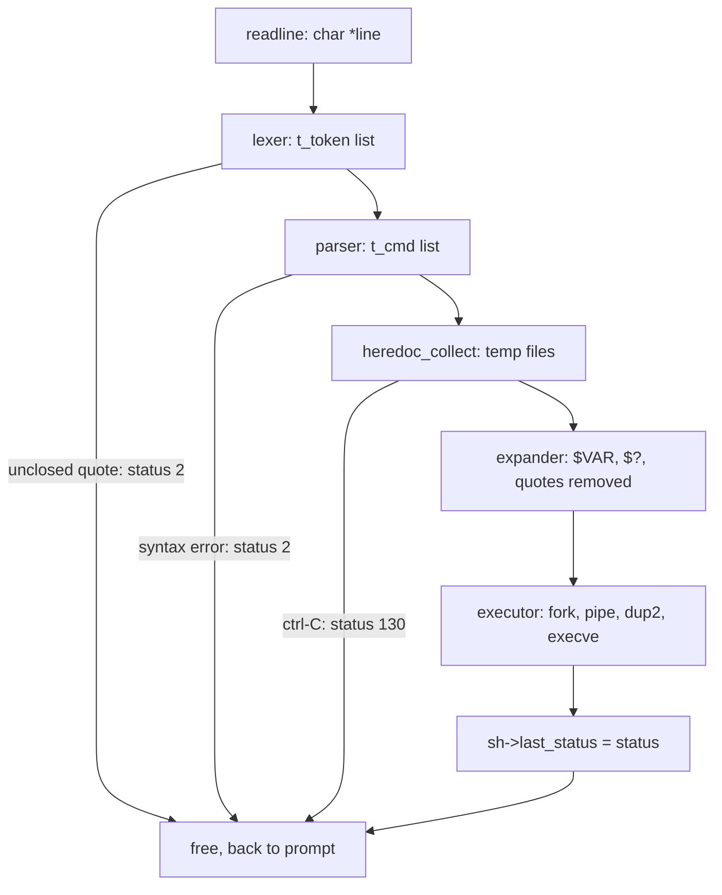
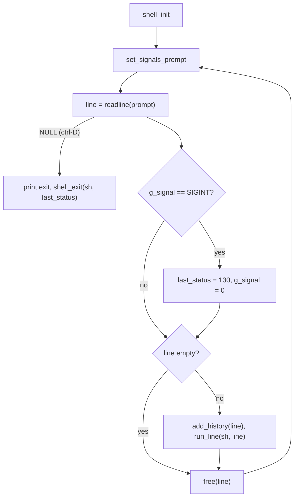
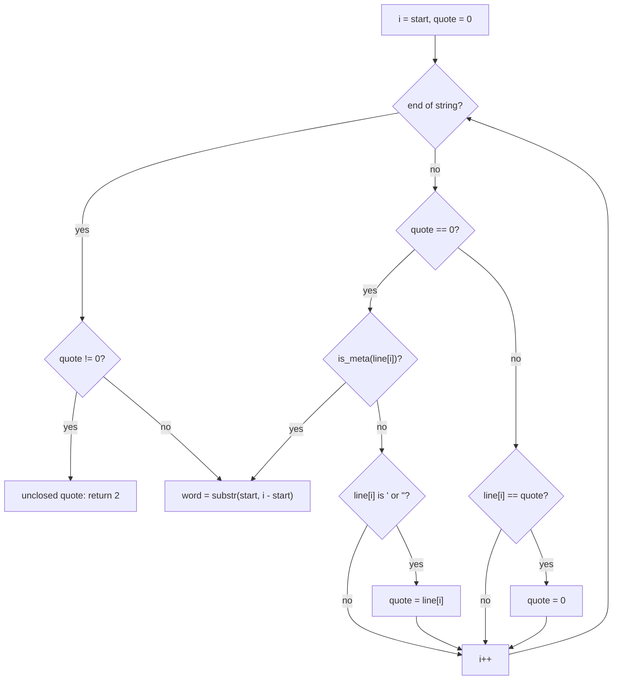
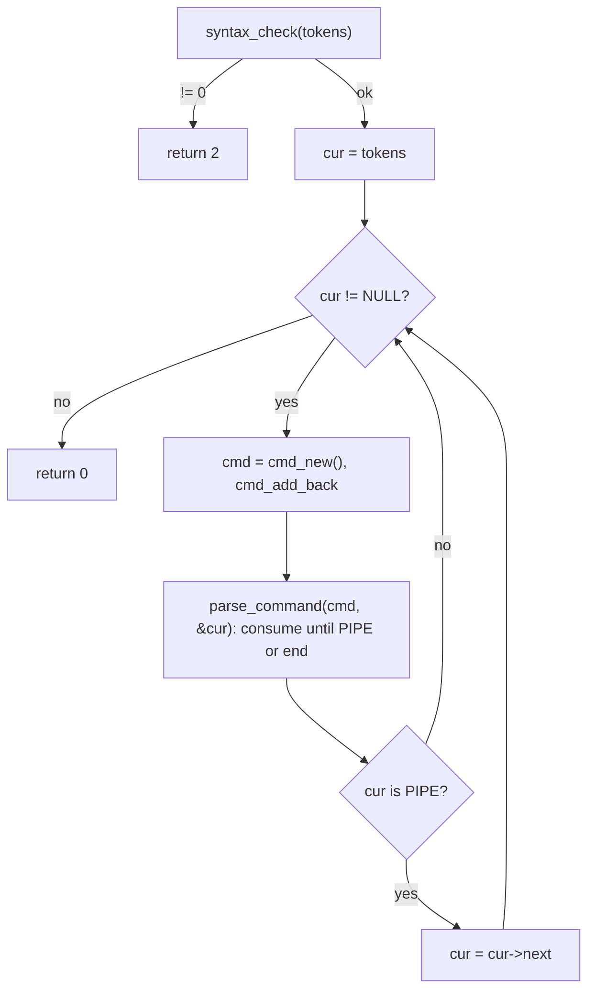
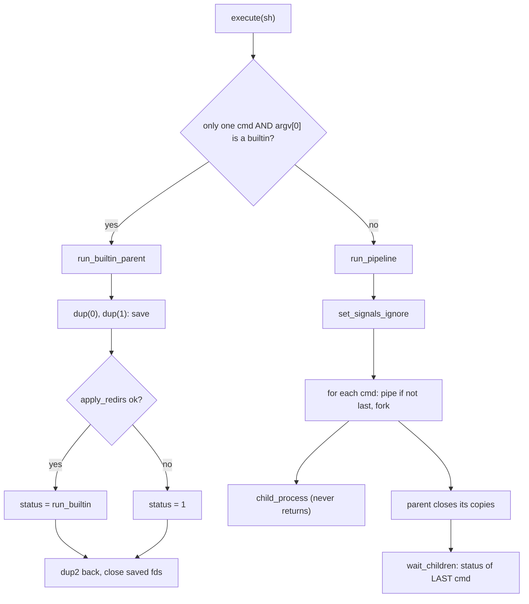
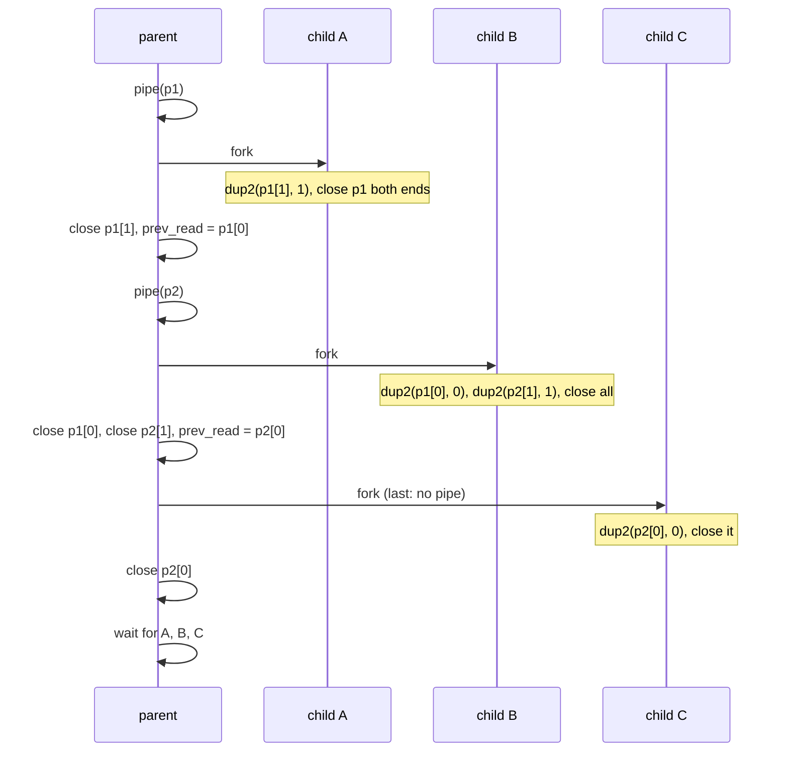
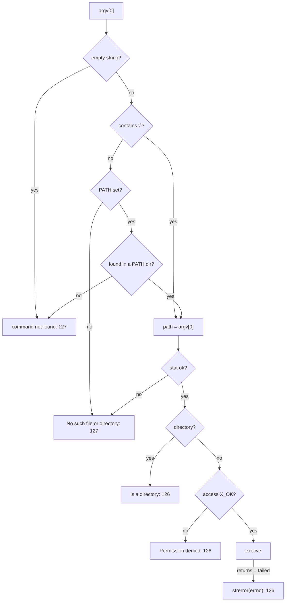
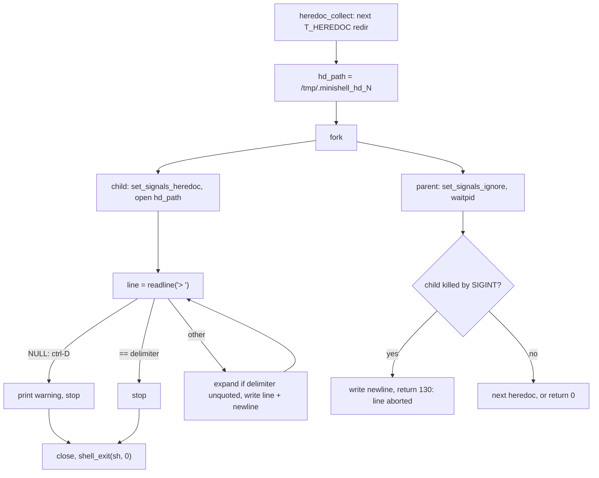

# Structure
<pre>
minishell/
├── Makefile
├── README.md
├── includes/
│   └── minishell.h            every include, the global, enums, structs, all prototypes
├── libft/                     your libft, with its own Makefile
└── sources/
    ├── main.c                 <b>[bahtiyor]</b> prompt loop
    ├── shell/                 <b>[baran]</b>
    │   ├── shell_init.c       shell_init <i>[ND]</i>
    │   ├── run_line.c         run_line, report_stage_error <i>[ND]</i>
    │   └── shell_exit.c       shell_exit <i>[ND]</i>
    ├── utils/                 <b>[baran]</b>
    │   ├── error.c            print_error <i>[D]</i>
    │   ├── free.c             free_strarr, free_tokens, free_redirs, free_cmds <i>[D]</i>
    │   └── str_utils.c        is_space, is_meta <i>[D]</i>
    ├── env/                   <b>[baran]</b>
    │   ├── env_init.c         env_init, env_new, env_add_back, env_free <i>[ND]</i>
    │   ├── env_access.c       env_get, env_set, env_unset <i>[ND]</i>
    │   └── env_array.c        env_to_array, env_count <i>[ND]</i>
    ├── lexer/                 <b>[baran + bahtiyor]</b>
    │   ├── lexer.c            lexer, read_operator, read_word <i>[D]</i>
    │   └── token.c            token_new, token_add_back, token_text <i>[D]</i>
    ├── parser/                <b>[baran + bahtiyor]</b>
    │   ├── parser.c           parser, parse_command <i>[ND]</i>
    │   ├── syntax.c           syntax_check, syntax_error <i>[ND]</i>
    │   └── cmd.c              cmd_new, cmd_add_back, argv_append, redir_append <i>[ND]</i>
    ├── heredoc/               <b>[baran]</b>
    │   ├── heredoc.c          heredoc_collect, heredoc_one, hd_make_path <i>[ND]</i>
    │   ├── heredoc_child.c    hd_child, hd_read_loop <i>[ND]</i>
    │   └── heredoc_cleanup.c  heredoc_cleanup <i>[ND]</i>
    ├── executor/              <b>[baran]</b>
    │   ├── execute.c          execute, run_builtin_parent <i>[ND]</i>
    │   ├── pipeline.c         run_pipeline, spawn_one <i>[D]</i>
    │   ├── child.c            child_process, exec_external <i>[D]</i>
    │   ├── wait.c             wait_children, report_signal, decode_status <i>[D]</i>
    │   ├── path.c             find_in_path, check_exec_path <i>[D]</i>
    │   └── redirect.c         apply_redirs, open_redir <i>[ND]</i>
    ├── expander/              <b>[bahtiyor]</b>
    ├── signals/               <b>[bahtiyor]</b>
    └── builtins/              <b>[bahtiyor]</b>
</pre>

Shell Execution Flow [REPL]:
	*-->Read user input-->Parse the input into commands-->Execute-->Wait for finish-->*

STEP 1: Readline
STEP 2: Parsing into Commands:
	2.1: Lexical Analysis/Tokenisation
			Breaking the input into WORDS and OPERATORS
				Example: echo "Hello World" | grep Hello > output.txt
				Would be tokenised as:
						- echo
						- "Hello World"
						- |
						- grep
						- Hello
						- >
						- output.txt
	2.2: Syntax Analysis/Parsing
			Organising tokens into a structured command format (AST or alternative command struct)
			Needs to be able to distinguish grammer structure
	
STEP 3: Execution of commands
	3.1:

Flowcharts:
1. Program Overview

2. Main Loop and run_line

3. LEXER and Tokenisation

4. Parser

5. Executor

6. The PIPELINE

7. exec_external and PATH lookup

8. HEREDOC

