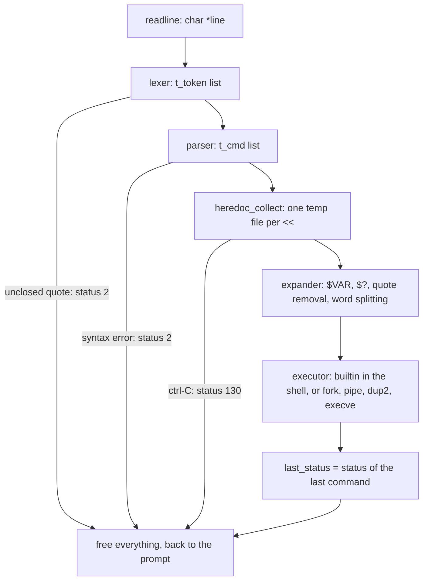

*This project has been created as part of the 42 curriculum by bkelav and bkarimov.*

# minishell (mandatory only)

## Description

minishell is a minimalist Unix shell written in C, modelled on bash 5.2. It follows the REPL: reads a command line with a prompt, splits it into tokens, builds a list of commands, expands variables and quotes, then runs the commands with `fork`, `pipe`, `dup2` and `execve`, and stores the exit status for the next line.

The goal of the project is to understand how a shell works underneath: processes and their file descriptors, pipes, redirections, environment variables, exit statuses and signals and the kernel.

### Features

- Prompt with a working history (using GNU readline).
- Running programs by relative or absolute path, or through the `PATH` variable.
- Single quotes (no interpretation) and double quotes (only `$` is interpreted).
- Redirections: `<`, `>`, `>>`, and `<<` (heredoc, with expansion unless the delimiter is quoted).
- Pipes: `cmd1 | cmd2 | ... | cmdN`.
- Environment variables (`$NAME`) and the last exit status (`$?`).
- ctrl-C prints a new prompt, ctrl-D exits the shell, ctrl-\ does nothing (at the prompt, as in bash).
- Builtins: `echo` with `-n`, `cd` with a relative or absolute path, `pwd`, `export`, `unset`, `env`, `exit`.
- Only one global variable, which holds the number of the received signal. The handler receives nothing but that number and cannot reach sh, which is a local of main. Additionally, handler calls the respective readline functions which are not async-signal-safe. So the handler stores the number in a volatile sig_atomic_t, and main reads it after readline returns and sets $? to 130. volatile stops the compiler from caching it, and sig_atomic_t guarantees the write is atomic.

Not implemented (bonus part): `&&`, `||`, parentheses, `*` wildcards, `;`, `\`, and unclosed quotes (reported as a syntax error).

## Instructions

### Requirements

- A C compiler (`cc`) and `make`.
- The GNU readline library with its headers (Debian/Ubuntu: `sudo apt install libreadline-dev`).

### Build and run

```sh
cd minishell
make            # builds libft, then ./minishell
./minishell
```

Other Makefile rules:

| Rule | Effect |
|---|---|
| `make clean` | removes the object files |
| `make fclean` | removes the object files and the binary |
| `make re` | `fclean`, then `make` |
| `make valgrind` | runs `./minishell` under valgrind (leaks, open fds, child processes), with `readline.supp` hiding readline's own memory |

### Examples

```sh
minishell$ export X=hello
minishell$ echo "$X world" | tr a-z A-Z > out.txt
minishell$ cat out.txt
HELLO WORLD
minishell$ cat << EOF | grep "$X"
> say $X
> bye
> EOF
say hello
minishell$ ls /nope
ls: cannot access '/nope': No such file or directory
minishell$ echo $?
2
```

## How it works

Each line goes through the same stages, in this order. Each stage only reads what the previous one produced.



### Technical choices

- **Lexer and parser.** The lexer only cuts the line into words and operators and keeps quotes in the words. The parser works in two passes: `check_syntax` validates the whole token list first, allocating nothing, then `build_cmds` builds the command list. So a syntax error never leaves half-built memory behind.
- **Heredocs first.** All heredoc bodies are read before anything is expanded or run, as bash does. Each body is read by a child process, so ctrl-C kills only that child and cancels the line with status 130. Bodies are stored in `/tmp/.minishell_hd_N`. The name is reserved with `open(O_CREAT | O_EXCL)`, so an existing file is never overwritten, and each file is unlinked as soon as the command opens it.
- **Expander.** One pass per word does variable expansion, quote removal and word splitting together: unquoted spaces from a variable split the word, quoted ones do not, and `""` stays an empty argument. A redirection whose word expands to zero or several words fails with `ambiguous redirect`.
- **Builtins.** A builtin that is alone on the line runs inside the shell, so `cd`, `export`, `unset` and `exit` can change the shell itself. In a pipeline it runs in a child, like any other command.
- **Environment.** The shell keeps its own copy of the environment as a linked list (`env_get`, `env_set`, `env_unset`), and turns it into a `KEY=value` array only right before `execve`, as per execve's parameter format.
- **Signals.** `sigaction` only. The handler stores the signal number in the one global variable, of type `volatile sig_atomic_t`, and redraws the prompt. Signal dispositions are set per situation: at the prompt, while waiting for children, in a child before `execve`, and in the heredoc child.
- **Exit status.** `$?` is the status of the last command of a pipeline. A child killed by a signal gives 128 + the signal number (130 for ctrl-C, 131 for ctrl-\).

### Source layout

```
minishell/
├── Makefile
├── readline.supp          valgrind suppressions for readline
├── includes/minishell.h
├── libft/
└── sources/
    ├── main.c             prompt loop
    ├── signals/           signal dispositions and handler
    ├── shell/             init, run_line, exit
    ├── lexer/             tokens
    ├── parser/            syntax check, command list
    ├── heredoc/           heredoc child, temp files
    ├── executor/          pipes, redirections, PATH, wait
    ├── env/               environment list
    ├── utils/             errors, free helpers
    ├── expander/          $VAR, $?, quotes, word splitting
    └── builtins/          echo, cd, pwd, export, unset, env, exit
```

## Resources

### References

- GNU Bash Reference Manual: https://www.gnu.org/software/bash/manual/bash.html
- POSIX Shell Command Language: https://pubs.opengroup.org/onlinepubs/9699919799/utilities/V3_chap02.html
- GNU Readline Library: https://tiswww.case.edu/php/chet/readline/readline.html
- Linux manual pages: `fork(2)`, `execve(2)`, `pipe(2)`, `dup2(2)`, `wait(2)`, `sigaction(2)`, `signal(7)`, `open(2)`, `unlink(2)`, `stat(2)`, `getcwd(3)`
- Computer Systems A Programmer's Perspective, Third Global Edition, Chapters: 8.2-8.5, 10.1-10.10.
- The Linux Programming Interface, Chapters: 6, 13.1-13.4, 21, 25-28.
- Operating Systems: Three Easy Pieces, Chapters: 4-5, 14. https://pages.cs.wisc.edu/~remzi/OSTEP/

### Use of AI

- **Explanations** of the system concepts behind the code by helping generate interactive visual demos for: processes and `fork`, file descriptor tables, pipes and end-of-file, `execve`.
- **Testing and debugging:** On top of our tests, to double check: scripts that compare minishell with bash on the same input, valgrind runs (leaks, open file descriptors, child processes), and gdb sessions. Several bugs found this way were then fixed: the ambiguous redirect, and heredoc temp files left behind by `exit`.
- **Comments and documentation:** help with drafting this README from the more comprehensive version.

